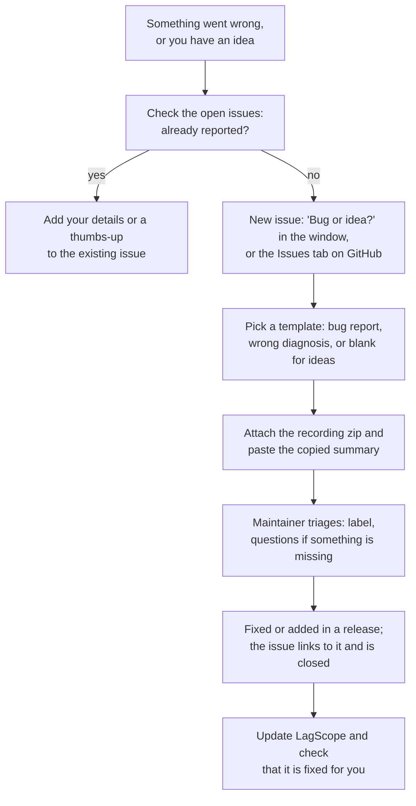
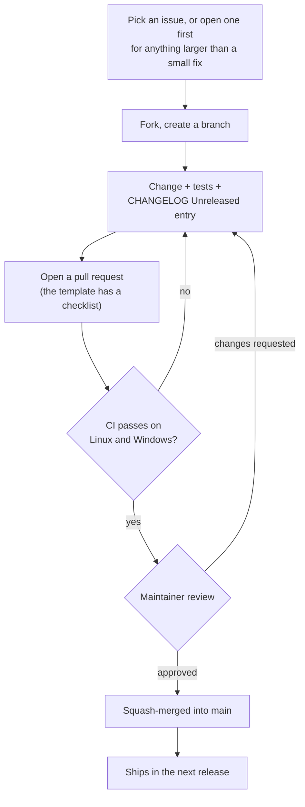

# Contributing

Bug reports, recordings where the diagnosis is wrong, game profiles and code are all welcome.

## Reporting a problem or an idea

Use the issue templates. For a wrong or unclear diagnosis, the recording's zip is what makes
it fixable: it lets the analysis be re-run and improved without your PC. See
[PRIVACY.md](PRIVACY.md) for what a recording contains before you share it. Security
problems go through a private report instead: see [SECURITY.md](SECURITY.md).

## Contributing code

`main` only changes through pull requests. Each needs passing CI and the maintainer's
approval, and is squash-merged so every change is one commit.

## Building and testing

See [Build](README.md#build) and [Develop](README.md#develop) in the README. In short:

- Linux / WSL: `./build.sh` runs the tests and cross-compiles the exe with cargo-xwin.
- Windows: `cargo test --release` and `cargo build --release` work natively with the MSVC
  toolchain (this is what CI does).
- The analyzer is platform independent: `cargo run --release -- analyze <recording folder>`
  rebuilds a report anywhere, so analysis changes can be developed against real recordings.

CI (`.github/workflows/ci.yml`) runs the tests on Linux and Windows and builds the exe for
every push and pull request.

## Ground rules

These are what make LagScope safe to run next to a game, so changes must keep them:

- **Passive.** Never open a handle to, inject into or read the memory of the game process,
  and never hook input. Game data comes only from ETW, performance counters and the
  kernel's process list. Anti-cheat systems (Easy Anti-Cheat and others) must have nothing
  to object to.
- **Do not cause what is being measured.** No Wi-Fi scans (`WlanScan`,
  `WlanGetNetworkBssList`) during a recording, no extra network traffic beyond the pings.
- **No network traffic or settings changes without a click.** Tests that send real traffic
  (the busy-connection test) or change settings (the Wi-Fi fix) run only when the user
  starts them; every settings change is asked for, journaled and undoable.
- **Privacy.** Anything that could identify the user or their network (network names, MAC
  addresses, PC / user names, global IPv6 addresses) is removed before it is written. New
  collectors that save system text go through `sysinfo::redact`.
- **Light.** Recording costs a few percent of one CPU core. Measure new collectors with
  `--gui-selftest record` (it logs CPU per thread).
- **Simple.** The window should stay understandable without a manual. Prefer improving the
  analysis over adding options.

## Analysis changes

- Add or update a test in `src/analyze/mod.rs` (synthetic sessions are built with `Synth`)
  for any new finding or changed threshold.
- Check real recordings before and after (`lagscope analyze <dir>`) and compare the
  headlines and scorecards.
- Thresholds should hold on desktops and laptops, Wi-Fi and Ethernet, NVIDIA and other GPUs.
- New or changed files and columns go into [docs/SESSION_FORMAT.md](docs/SESSION_FORMAT.md);
  it is also copied into every recording as the guide for AI assistants.

## Game profiles

A profile is a small JSON file (see [Game profiles](README.md#game-profiles)). If you add a
built-in one, include a recording of a match so the match detection and gap thresholds can
be checked.

## How issues are handled

Labels: `bug`, `analysis` (wrong or unclear diagnosis), `enhancement`, `game-profile`,
`needs-info` (waiting for details or a recording), `good first issue`. An issue is closed
when the release that fixes it is out, or when it cannot be acted on (e.g. `needs-info` with
no answer for 30 days).

## License

By contributing you agree that your contribution is licensed under the [MIT License](LICENSE).
