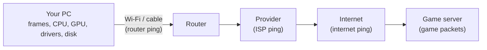
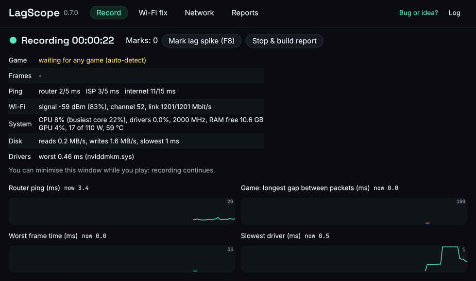
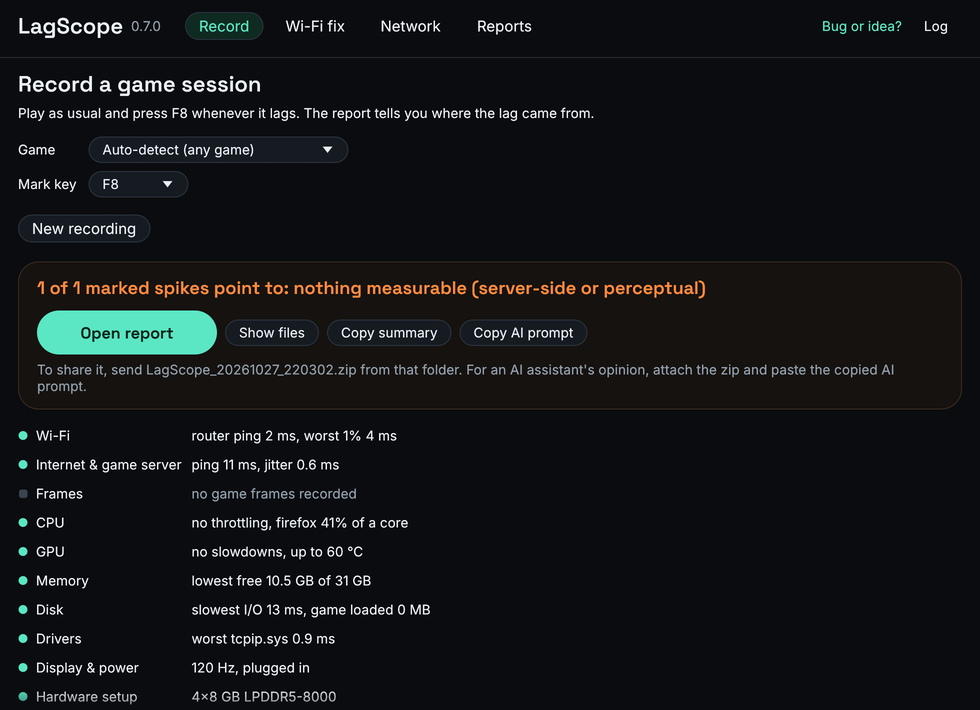
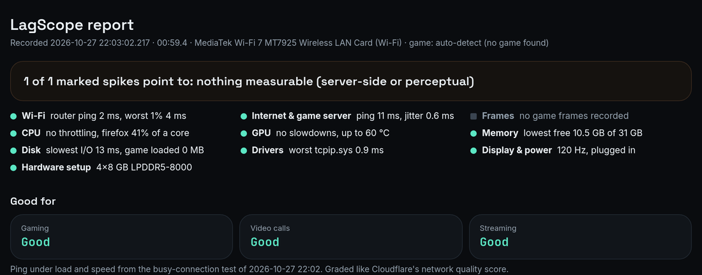

# LagScope

Lag / hiccup diagnostics for online games on Windows. It started with THE FINALS and works with any game through per-game profiles. Double-clicking the exe opens a small native window (egui, OpenGL) with four tabs: Record, Wi-Fi fix, Network and Reports. The window redraws at most once a second while recording and not at all when idle. Run with arguments, the same exe works as a console tool (`--console` for the text menu). The two modes:

- **Wi-Fi check & fix** (desktop, game closed): offers Wi-Fi/Bluetooth driver updates from Windows Update, measures the router ping, then switches suspect settings off one at a time (roaming, power saving, band, Bluetooth, Location, Wi-Fi Direct, Windows background scanning). Each one is restored right after its test, and the check offers to keep the one that removed the freezes. Every change is journaled in `%ProgramData%\LagScope`, so an interrupted test is undone at the next start.
- **Network** (on request): router / ISP identification (UPnP description, admin page, reverse DNS of the first ISP hop), latency under load (bufferbloat grade, via WinHTTP to Cloudflare's speed test), and a Wi-Fi neighbourhood scan (congestion per channel; no neighbour names are stored). Results are saved as sessions.
- **Compare**: any two sessions side by side (Reports tab, or `lagscope compare A B`).
- **Record while playing** (passive): records game packet timing, pings, frame times, Wi-Fi, NDIS driver requests, CPU/GPU data, disk activity and game hard page faults (to separate asset-streaming stutter from network lag), other programs' CPU use (from the kernel's process information, no handles), CPU power/thermal limits, free RAM, power source, display refresh rate, whether the game is the foreground window (frames around an alt-tab are not judged), network link speed/drops/errors, a one-time hardware snapshot (RAM sticks and speed vs. rating, which adapter the monitor is plugged into, the graphics card's PCIe link under load and power limit, drives, driver/BIOS age), and **driver latency**: every driver's DPC and interrupt-handler run times, LatencyMon-style, from a private kernel ETW session. When you stop it, it builds an offline HTML report with a one-line-per-area scorecard (network, frames, CPU, GPU, memory, disk, drivers, display & power, hardware setup) and shows where each marked lag spike came from. Driver & disk tracing can be turned off (Record tab > Advanced, or `--no-kernel-trace`).

Works on Wi-Fi and wired connections (on a cable, Wi-Fi events are ignored and the first hop is judged as a wired link). GPU temperatures, clock limits, power limit and PCIe link come from NVIDIA's NVML; on AMD and Intel graphics only GPU load is recorded (Windows' GPU engine counters). Frame times come from DXGI present events, so games that render with Vulkan or OpenGL without a DXGI swap chain show no frame data.

End-user instructions are in [README.txt](README.txt), which ships inside the release zip. **[How LagScope works](docs/HOW_IT_WORKS.md)** explains what is measured where, how a lag spike gets its verdict, and what the scorecard means.



A problem shows up at the first link where it appears: if the router ping is clean but the internet ping and the game stall together, the cause is past your router, not your PC or Wi-Fi.

| Recording | Result |
|---|---|
|  |  |



## Sharing a recording and AI analysis

Every recording is also a zip, ready to send. For a quick post, **Copy summary** (on the result, or Reports > More) copies the verdict, the scorecard and the top suggestions as plain text.

The built-in analysis is hand-written rules. For a second opinion, or a question it does not cover, give the zip to an AI assistant that can open files and run code (e.g. ChatGPT or Claude with file analysis):

1. Click **Copy AI prompt** and paste it into the chat. It says what LagScope found, when you marked lag spikes, and what to check; fill in what you noticed.
2. Attach the recording's zip.

Each recording contains `AI_GUIDE.md`, which explains every file and column to the assistant (the same text as [docs/SESSION_FORMAT.md](docs/SESSION_FORMAT.md)). The same text is available from the command line: `lagscope summary <dir>` and `lagscope ai-prompt <dir>`.

What a recording contains, and what is removed before it is saved: [PRIVACY.md](PRIVACY.md).

Found a bug or have an idea? [Open an issue](https://github.com/sevencooper/LagScope/issues/new/choose) ("Bug or idea?" in the window links there too). How issues are handled and how to contribute code: [CONTRIBUTING.md](CONTRIBUTING.md). Security problems: [SECURITY.md](SECURITY.md). What changed in each version: [CHANGELOG.md](CHANGELOG.md). For maintainers: [releasing](docs/RELEASING.md) and [repository settings](docs/REPO_SETTINGS.md). License: [MIT](LICENSE).

## Build

The exe is cross-compiled from Linux or WSL. Windows itself only needs the finished exe.

One-time setup:

```sh
curl https://sh.rustup.rs -sSf | sh         # Rust toolchain
rustup target add x86_64-pc-windows-msvc
cargo install cargo-xwin                     # downloads the MSVC SDK on first build
```

Build:

```sh
./build.sh                    # tests + release build -> dist/LagScope.zip
./build.sh /mnt/c/some/dir    # same, and also copies the exe + README there
```

The result is one static `lagscope.exe` with no runtime dependencies. It asks for admin rights when it starts, because ETW tracing needs them.

## Game profiles

Built in: `the_finals`, `cs2`, and `auto`, which picks the process presenting the most frames. `lagscope.exe games` lists them. To add a game, drop a JSON file into a `profiles` folder next to the exe, or into `%ProgramData%\LagScope\profiles`:

```json
{
  "id": "apex",
  "name": "Apex Legends",
  "processes": ["r5apex.exe"],
  "ignore_ports": [],
  "match_detection": "send_rate",
  "min_gap_ms": 80,
  "tick_merge_ms": 5,
  "hint": "What to look for in this game at each hiccup."
}
```

Only `id`, `name` and `processes` are required. What the other fields mean:

- `ignore_ports`: remote UDP ports that are never the game server, e.g. latency beacons.
- `match_detection`: how match play is told apart from menus.
  - `send_rate`: seconds in which the client sends at least half its peak rate count as play.
  - `none`: the whole session counts as play.
- `min_gap_ms`: the smallest silence in the server stream that counts as a stall.
- `tick_merge_ms`: packets that arrive within this many ms count as one server tick.

A file with the same `id` as a built-in replaces it. The profile is saved in each session's `meta.json`, so `analyze` re-runs with the same settings.

## Develop

- `cargo test`: analyzer tests (they run on Linux).
- `lagscope summary <dir>` / `lagscope ai-prompt <dir>`: a recording's result as plain text, and the prompt for an AI assistant.
- `cargo run --release -- analyze <session folder>`: rebuilds `report.html` from a recorded session. This lets you tweak the analysis without replaying a game.
- `lagscope.exe --help`: capture options (hotkey, extra ping targets, duration, ...).
- `lagscope.exe --record --game <id>`: record with a given profile (the menu remembers the last one).
- `lagscope.exe wifi-inventory [--wu]`: read-only. Shows what the Wi-Fi check would test on this PC, and with `--wu` the driver updates Windows Update offers.
- `lagscope.exe --gui-selftest <idle|record|close|prompt|wifi|compare|network|reanalyze> <out dir>`: scripted GUI run. It saves screenshots (BMP) and `selftest.txt` with CPU and memory figures (the `record` run also logs steady-state CPU per thread), then closes. Pass `--out <dir>` to list reports from that folder. `wifi` runs a short Wi-Fi check, so settings change temporarily.
- `lagscope.exe --wifi-check --unattended --force-tests --check-secs 15`: runs every test with no questions and keeps nothing. Use this to try the check end to end.

Layout:

- `src/win/`: Windows collectors (ETW, pings, Wi-Fi, CPU/GPU, hotkey, system info).
- `src/win/wificheck.rs`, `src/win/fixes.rs`: the guided Wi-Fi check, plus the reversible settings changes it makes.
- `src/win/gui.rs`: the window. It is a thin front-end over `capture::start` / `Capture::finish`, the same engine the console uses.
- `src/win/drivers.rs`: driver DPC/ISR latency from a private kernel ETW session.
- `src/profile.rs`: game profiles and settings.
- `src/win/router.rs`, `loadtest.rs`, `wifiscan.rs`, `netreport.rs`: the Network tab.
- `src/analyze/health.rs`: PC-side checks (background CPU at hitches, CPU limits, memory, power, display, link) and the scorecard.
- `src/analyze/hardware.rs`: hardware set up wrong (XMP/EXPO off, mixed or single RAM sticks, monitor on the motherboard, slow GPU link, lowered GPU power limit, full or spinning system drive, CPU capped by the power plan).
- `src/analyze/compare.rs`: session comparison.
- `src/analyze/share.rs`: "Copy summary", "Copy AI prompt" and the `AI_GUIDE.md` written into each recording.
- `src/analyze/`: platform-independent analysis and report generation.
- `src/report/`: the HTML template and the bundled uPlot charting library.
- `src/theme.rs`, `src/win/look.rs`, `src/fonts/`: the look shared with LagScope Pulse. `build.rs` reads the colours, radii, fonts and status shapes from [lagscope-core](https://github.com/sevencooper/lagscope-core)'s `design/tokens.json` (`lagscope_core::design::TOKENS_JSON`) at the version pinned in `Cargo.toml`. The fonts are under the SIL Open Font License (`src/fonts/OFL.txt`).
