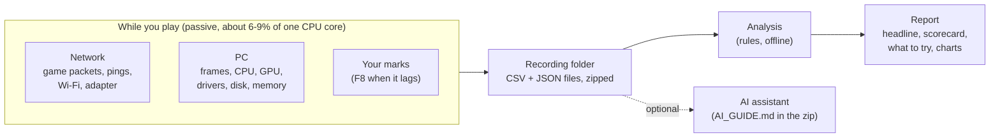
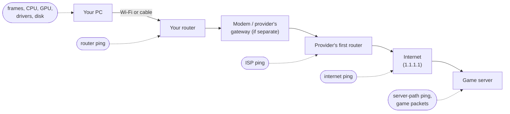
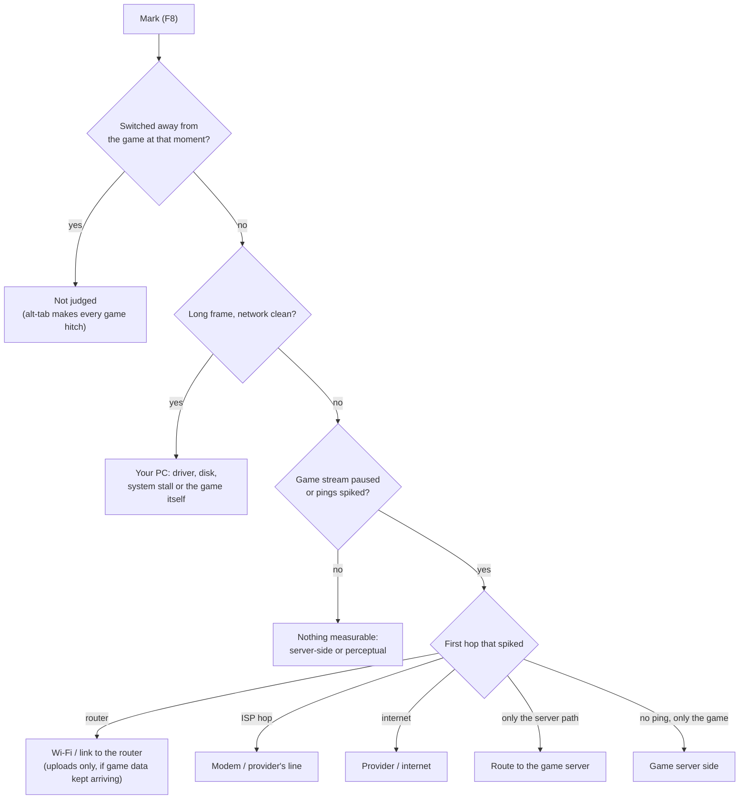

# How LagScope works

LagScope answers one question: **where does the lag come from?** Your PC, the Wi-Fi or
cable to your router, the modem / your provider, the wider internet, or the game server.
It records timing from many places at once while you play, then compares them: whatever
went wrong first, and where, is the cause.

## The pieces

Recording only measures; it never touches the game process (no injection, no memory
reading), so it is safe with anti-cheat. The analysis runs after you stop and needs no
internet; it can be re-run later with a newer LagScope (Reports > More > Rebuild report).

## Where on the path each measurement looks

Your game's data travels a chain of hops. LagScope measures each link of the chain
separately, so a problem shows up at the first link where it appears:

| Measurement | What it covers | How often |
|---|---|---|
| **Game packets** | The game's own traffic, both directions: when packets arrive and leave. A pause in the server's stream is what you feel as lag. | every packet |
| **Router ping** | PC ↔ your router: the Wi-Fi or cable. | 20 per second |
| **ISP ping** | ... ↔ your provider's first router (a second router or the provider's gateway in between is skipped). | 20 per second |
| **Internet ping** | ... ↔ 1.1.1.1, a well-connected server, standing in for "the internet". | 20 per second |
| **Server-path ping** | ... ↔ the game server, or the last router before it that answers. | 20 per second |
| **Frames** | When the game hands each frame to the screen. A long gap is a stutter on your PC. | every frame |
| **Wi-Fi** | Signal, link speed, channel, background scans, roaming. | 4 per second |
| **CPU, memory, GPU** | Load, clock limits (heat / power), free RAM, other busy programs. | 4 per second |
| **Drivers** | How long each driver keeps a CPU core busy (LatencyMon-style). | every run |
| **Disk** | Reads, writes, slow moments, the game loading data. | per second |
| **System snapshot** | Windows version, hardware, driver versions, network adapter settings. | once at the start |

The full list of files and columns: [SESSION_FORMAT.md](SESSION_FORMAT.md). What is kept
private: [PRIVACY.md](../PRIVACY.md).

## Reading the chain

Because each hop has its own ping, a problem localises itself:

| What spikes | What stays clean | Where the problem is |
|---|---|---|
| frames | network | your PC (frame hitch) |
| router ping and everything after | — | the Wi-Fi or cable to your router |
| ISP ping and after | router ping | the modem, provider's gateway or the line |
| internet / server ping, game packets | router and ISP ping | past your provider's first router, or the gateway's routing |
| game packets only | every ping | the game server or the route to it |
| pings via the router, game data still arriving | — | your **uploads** were held back (feels like rubber-banding) |

## How a marked lag spike gets its verdict

When you press F8, LagScope looks at the 4 seconds before the key press (people press a
moment late), and at 10 seconds if those were clean:

The headline is the verdict most marks agree on. Without marks, LagScope uses patterns
in the whole recording instead.

## Timers

The most useful pattern is a **timer**: freezes that come back at a fixed interval, such as
every 10 seconds. Interference, a weak signal or a busy network are random; a fixed beat
means a device or program does something on a schedule (a router feature, the adapter's
firmware, a background task).

LagScope looks for beats in every series (game pauses, each ping). It tolerates skipped
beats (a timer that fires every 10 s but only hits every second or third time shows gaps
of 10, 20 or 30 s), and checks that the beat is clearly more regular than chance. Where the
beat appears tells where the timer is:

- on the router ping: the Wi-Fi link or the router;
- on the game stream and internet pings, with the router ping clean: past your router
  (modem / provider's gateway or the provider);
- a beat locked to the same point within each second: a 1-second timer in the router or the
  adapter's firmware.

## The scorecard

| Line | Worth a look (orange square) when |
|---|---|
| Wi-Fi / Network link | the router ping is unstable, freezes on a timer, uploads freeze, or the link drops |
| Internet & game server | game stalls are frequent, the internet ping is bad, or pauses run on a timer past the router |
| Frames | about one hitch (50 ms+) per minute of play or more |
| CPU | the CPU is held back by heat / power, or a program is busy during stutters more than usual |
| GPU | heat / power limits line up with stutters (desktops: also when at the limit a fifth of the time) |
| Memory | free RAM runs low, or Windows pages heavily |
| Disk | the disk is held up several times while playing, or hitches line up with loading |
| Drivers | a driver runs long, often, while playing |
| Display & power | refresh rate below the monitor's best, on battery, power saver, CPU capped by the plan |
| Hardware setup | RAM below its rated speed, single channel, monitor on the motherboard, slow GPU link, ... |

Only match play counts for game- and PC-side lines: loading screens, menus, the first
seconds of a match and moments you were alt-tabbed are shown but not judged.

## Shared with LagScope Pulse

Some results are worked out by [lagscope-core](https://github.com/sevencooper/lagscope-core),
the engine the app shares with the LagScope Pulse website, so the same line gets the same
grade and the same words in both:

- **Jitter:** the average change between one internet ping and the next (Cloudflare's
  definition), shown next to the ping.
- **Good for** gaming, video calls and streaming: Cloudflare's network quality steps (ping,
  jitter, loss, ping under load, download speed), plus one rule of LagScope's own: freezes
  keep gaming at Average at best. A recording measures ping, jitter and loss itself; ping
  under load and speed come from the busy-connection test (Network tab) on the same router,
  the one closest in time within two weeks. Without one, those grades say "Not measured yet".
- **Under load:** the busy-connection test is worth a look when the ping rises more than
  50 ms while the line is full.
- **Wording:** a timer, freezes and upload freezes are described in the same sentences as on
  the website (core's `design/wording.md`), with LagScope's extra: where on the path it is.

The report also lists **every pause**: each time the game's data stopped for 100 ms or more
during play, which way (to you or from you), whether the packets were held and then arrived
together, never arrived, or were not sent by this PC, and the likely cause, judged like a
marked spike on the second around it.

## Glossary

- **Ping / RTT:** time for a tiny packet to go somewhere and back.
- **Stall / pause:** a gap in the game server's stream of packets; 100 ms+ is a stall you
  can feel.
- **Jitter:** how unevenly packets arrive.
- **Bufferbloat:** delay that builds up when a connection is full (downloads, uploads).
- **DPC / interrupt:** short bursts of work drivers do on a CPU core; when they run long,
  everything else on that core waits.
- **Committed memory:** memory programs have reserved (RAM + page file), mostly unused; the
  RAM actually in use is what Task Manager shows.
- **Double NAT:** two routers in a row, e.g. your router behind the provider's gateway.
- **Bridge mode:** the provider's gateway acting only as a modem, so your own router does
  the routing.
