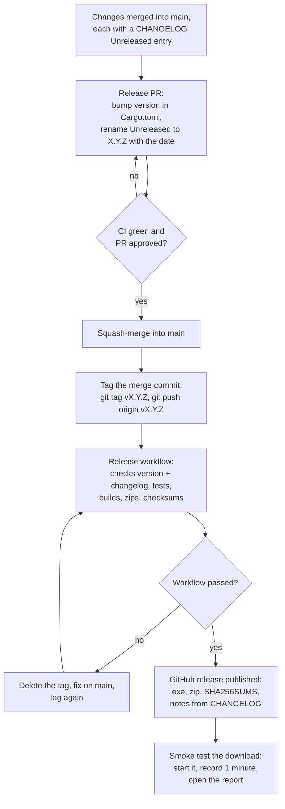

# Releasing

Releases are built by GitHub Actions, not on a developer's PC: pushing a version tag runs
`.github/workflows/release.yml`, which tests, builds, packages and publishes.



## Steps

1. **During development**, every user-visible change adds a line under `## Unreleased` in
   [CHANGELOG.md](../CHANGELOG.md), written for users (what they will notice).
2. **Release PR.** Set `version` in `Cargo.toml` (then `cargo build` to update `Cargo.lock`)
   and rename `## Unreleased` to `## X.Y.Z (YYYY-MM-DD)`. Add a fresh empty `## Unreleased`
   at the top. Merge once CI is green.
3. **Tag** the merge commit on `main`:
   ```sh
   git switch main && git pull
   git tag vX.Y.Z
   git push origin vX.Y.Z
   ```
4. **Watch** the Release workflow (Actions tab). It refuses to publish if `Cargo.toml` or the
   changelog does not match the tag.
5. **Smoke test** the published download on Windows: it starts, a 1-minute recording works,
   the report opens.

If the workflow fails, delete the tag (`git push --delete origin vX.Y.Z`, `git tag -d vX.Y.Z`),
fix the problem through a normal PR, and tag again. Never change a published release's files;
publish a new patch version instead.

## Version numbers

`MAJOR.MINOR.PATCH`. Until 1.0: **minor** for new features or changed behaviour, **patch** for
fixes only. 1.0 marks the first public release that strangers are expected to use.

## Local builds

`./build.sh` (Linux / WSL, cross-compiled) still produces the same package in `dist/` for
testing a build before tagging. The published files always come from the workflow.
